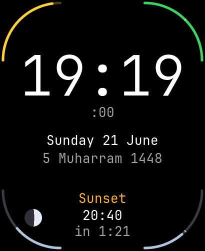

# Astronomical Watch

A personal low-power astronomical watch based on the **Waveshare ESP32-S3-Touch-AMOLED-2.06**.

It shows the time, date and astronomical information computed on the device. Location, date/time,
UTC offset and the other settings are entered on a setup page that the watch serves over its own
Wi-Fi for a few minutes (started on the watch), from any phone or computer browser; no internet,
GPS or online service is used. Battery life has priority over features: the processor sleeps most
of the time. Between interactions a dim
always-on face shows the time; when the watch has not moved for a while, it switches itself off
and the PWR key turns it on again.

## Planned Features

- Time and date
- Sunrise, sunset, solar noon, civil/nautical/astronomical twilight, day length
- Moon phase, illumination, age, moonrise and moonset
- Planets: Mercury to Neptune in the solar system and in the sky, their rise and set, their
  distance and light time
- Gauges in the four screen corners, chosen in the setup portal: the battery, the day or night,
  the Moon's time above or below the horizon, its phase, the time to the next prayer, sunrise,
  sunset, moonrise or moonset, the week, month, Hijri month or year, a day counter, the Sun's
  altitude, the hour, minute or second; while charging, the battery gauge fills up in white
- Alarms at a clock time on chosen weekdays, or relative to a sun or moon event or a prayer time
  (sunrise, twilights, solar noon, sunset, moonrise, moonset), with an offset; the countdown
  rings too; the board has no vibration motor, so they beep through the speaker
- PWR key opens the interactive mode (touch, pages); after a configurable timeout the watch
  returns to a dim always-on face, updated once a minute, or switches off (setting)
- Switches off after a long time without motion (checked at wide intervals); the PWR key turns it on
- Switches off at 10 % battery, so that the clock keeps time for days; the PWR key still shows the
  watch until the display timeout
- Setup page over the watch's own Wi-Fi, started with a button on the watch's Setup page and
  stopped by the button, a save or a timeout (captive portal; a phone joins by scanning a QR code
  on the watch, or with the network name and password shown there): time and UTC offset from the
  browser, location from a country/city list or coordinates pasted from a map app, and every
  other setting

## Screenshots

| Always-on faces | Face pages |
|---|---|
|  |  |

Every page and part, the default face pages, and the setup portal: **[English](docs/screenshots/en/README.md)** ·
**[Türkçe](docs/screenshots/tr/README.md)**. Taken from the watch in a fixed scene (Istanbul,
21 June 2026, 19:19); the always-on face is shown at full brightness, the watch dims it.

## Install and Update

Releases are on the project's release page (GitLab and GitHub), each with two files:

- `astronomical_watch-<version>-full.bin`: the first install over USB, one command
  (Python's esptool; if no port appears, hold BOOT while pressing PWR for the download mode).
  It also clears the settings, so it is meant for the first install only:

  ```bash
  pip install esptool
  esptool --chip esp32s3 -p /dev/ttyACM0 write-flash 0x0 astronomical_watch-<version>-full.bin
  ```

- `astronomical_watch-<version>.bin`: later updates from a phone, no computer needed: start the
  setup portal on the watch (Settings, Wi-Fi setup) and follow its "Software update" page.

## Hardware

Waveshare ESP32-S3-Touch-AMOLED-2.06: ESP32-S3R8, 410 × 502 AMOLED (CO5300), FT3168 touch,
QMI8658 IMU, PCF85063 RTC, AXP2101 PMIC, battery connector.
Pins, power tree and device notes are in [docs/hardware.md](docs/hardware.md).

## Software

ESP-IDF v6.1, C++17, LVGL, Waveshare board support package.

## Build and Flash

For development (see [CLAUDE.md](CLAUDE.md) for the release and battery-test builds):

```bash
source ~/.espressif/v6.1/esp-idf/export.sh
idf.py build
idf.py -p /dev/ttyACM0 flash monitor
```

## Host Tests

The astronomy code (`main/Astronomy.*`, `main/Hijri.*`) does not depend on ESP-IDF and is tested
on the computer against reference values from [Skyfield](https://rhodesmill.org/skyfield/) with
NASA JPL's DE421 ephemeris, and against the Hijri month starts published by Turkey's Diyanet:

```bash
sh tests/run_host_tests.sh          # needs only g++
```

The reference values are in the repository. To make them again (Python, about 20 MB):

```bash
sh tools/setup_reference.sh         # Skyfield and the ephemeris in tools/.venv
tools/.venv/bin/python tools/make_astronomy_reference.py > tests/astronomy_reference.csv
```

## Project Structure

```text
astronomical-watch/
├── CLAUDE.md             development rules
├── README.md
├── CMakeLists.txt
├── sdkconfig.defaults    project configuration (sdkconfig is generated)
├── dependencies.lock     locked component versions
├── docs/hardware.md      hardware fact base
├── partitions.csv        flash layout (two 4 MB application slots for updates)
├── docs/screenshots/     pictures of the watch pages, in English (en/) and Turkish (tr/)
├── tools/guided_test.py  guided hardware tests
├── tools/screenshot.py   screenshots from the watch (development build)
├── tools/read_events.py  the watch's event log over USB (stability on the wrist)
├── tools/make_cities.py  city list of the setup page, from GeoNames
├── tools/setup_reference.sh  Python environment for the astronomy reference values
├── tools/make_fonts.sh   watch fonts (main/fonts/) from tools/fonts/, needs Node.js
├── tools/make_aod_glyphs.py  always-on bitmaps (main/AodGlyphs.c), needs Pillow (tools/.venv)
├── tools/make_gifs.py    README animations from the screenshots, needs Pillow
├── tools/portal_preview.py  the setup portal's pages on localhost with a fake watch; pictures
├── tools/make_corner_table.cpp  corner gauge pixel table (main/CornerTable.c)
├── tests/                host tests of the astronomy code and their reference data
├── main/                 application
└── archive/              earlier QMI8658 validator (reference only)
```

## Status

Restarted on ESP-IDF with C++17. The watch puts the unused peripherals into their lowest-power
state. A PWR press starts active mode: five pages swiped sideways show the watch face, the clock, the
information, the planets and the settings. The watch face is a set of pages composed in the setup portal: a
clock (JetBrains Mono or seven-segment digits, or analog in five styles), large or among the
Sun's and the Moon's orbits or their paths over the horizon with the Milky Way and the planets, with up to four lines and four corners of
information around it (the time, the date, Hijri date, next prayer time or sunrise or sunset with the time
left, a day counter, a world clock city, the battery, the Sun's or the Moon's altitude, the
weekday ring, the Moon's phase, the hour, minute or second, an alarm's days, the alarm bell, a
running timer); a vertical swipe steps the face
pages and the parts of the last three pages.
The clock, information and settings pages show their name at the top between the corner gauges.
The clock page holds a world clock (three cities that follow their daylight saving time), a
stopwatch with laps and a countdown (both keep running while the watch sleeps), Gregorian and
Hijri month calendars (a sideways swipe steps the month; a tap chooses a day on both calendars),
day counters and the alarms (a tap switches one on or off; an alarm that is on keeps the watch
from switching itself off, so the battery lasts shorter). The information page
holds the Sun (rise, set, noon, day length, time left until sunset), the twilights with the
golden and blue hours, the prayer times by Diyanet's method, the Moon (phase, rise and set, the
dark part of the night, the new crescent, the Hijri date), a sun compass, the time (solar,
equation of time, ezani, qibla time, sidereal, week and day), the battery details (with the
time since the charger was unplugged) and an About
page. The settings page holds the settings (display timeout, always-on, development mode,
auto-off, screen on while on USB; one tap per value, kept in flash), what the portal set, and the
setup portal, which opens the watch's own Wi-Fi for a phone or computer, whose browser sets the
time, time zone, location, world clock cities, day counters and settings, and shows a short
help page; each save also corrects the clock's rate. The portal also composes the face pages, orders
them and the stacked pages' parts, and hides the ones not wanted. The watch and the page speak English or
Turkish. New versions install from a phone through the same page, which also hands over the
watch's event log and crash dump for a report. A long press and a
drag on the watch face sets the brightness: vertically the face's, sideways the always-on face's
by day or by night. 10 s after the last touch
(the default), or at the next PWR press, a
dim form of the face page shown (its clock and the items marked for it), at a brightness of its
own by day and by night (switched at sunrise and sunset), stays on the display
while the processor deep-sleeps, redrawn once a minute. On every page and on the always-on face
the four screen corners are gauges chosen in the portal (by default the day or night, the
battery, the Moon's time above or below the horizon and its phase). While the battery charges, a white part grows from its level to
the full end in active mode; the always-on face shows that part in white from its next minute.
Every 10 min the accelerometer is read once; when the watch has not moved for 30 min it
switches itself off through the power-management IC, and a PWR press of at least half a second
turns it on again.
The earlier Wake-on-Motion validation results are kept in `docs/hardware.md`, and the validator
itself in `archive/wom-validator/` (git tag `wom-validator`).

## Roadmap

Each step is built, verified on the board and documented before the next one starts.

1. **M1** (done): PWR key wake from deep sleep, wake statistics kept across sleep.
2. **M2** (done): unused peripherals in their lowest-power state, battery drain runs (about 1.5 mA
   remained in deep sleep; holding the idle pads lowered it to about 1.2 mA, an estimate
   calibrated with a known load; the search continues).
3. Off mode (done): software power-off through the AXP2101 and power-on with the PWR key; the
   battery charges while the watch is off.
4. **M3** (done; crystal drift measurement running): RTC (PCF85063) time in UTC, set from the
   host, kept through off mode.
5. **M4** (done): display basics (time, date and battery through LVGL; panel power on ALDO2).
6. **M5** (done): always-on face with a minute-aligned wake; wake time 0.37 s per minute with
   `CONFIG_BOOTLOADER_SKIP_VALIDATE_IN_DEEP_SLEEP`; about 3 mA in always-on with the panel's
   idle mode (estimate from battery runs; about 45 h per charge of the supplied cell, which
   behaves like about 150 mAh).
7. **M6** (done): motion check at wide intervals in always-on (one 0.1 s accelerometer reading
   every 10 min, 10 mg threshold measured on a desk and on the wrist; power-off after 30 min
   without motion).
8. **M7** (done): active mode (touch, two swipeable pages, display timeout, PWR press to always-on).
9. **M8** (done): settings in NVS and the settings page on the watch (display timeout, always-on,
   brightness, auto-off; the setup button, password and IP address follow with M9).
10. **M9** (done): setup portal over Wi-Fi (time, UTC offset, location, all settings; the page
    opens by itself on a phone, the time is set to within a few milliseconds of the browser's
    clock) and the local time on the faces; the minute wake did not grow with the Wi-Fi stack.
    An About page and screenshots from the watch came with it.
11. **M10** (done): astronomy on the watch (sun and moon events and positions, twilights,
    golden and blue hour, sun compass, Hijri date by local crescent visibility or Diyanet's rule),
    a monospaced font with the Turkish letters (JetBrains Mono), watch face layouts and
    always-on styles chosen with a vertical swipe or in the setup portal, with selectable items,
    the power cost of the always-on styles (battery run V: no visible cost of lit pixels), the
    corner gauges, the always-on brightness by day and by night, and two faces with the Sun's and
    the Moon's paths.
12. **M11** (done): languages: Turkish and English on the watch and the setup page, chosen in the
    settings or on the page; software updates from a phone through the setup portal, with a
    return to the previous version if the new one does not start; the event log and crash dump
    downloaded from the same page. First release: v0.0.1. v0.0.2: the charging indicator, and the
    PWR key on boards whose key line lacks its pull-up resistor.
13. **Face templates** (done): face pages composed in the portal, the Large, Full arcs and Half
    arcs templates with both digital clocks and five analog styles, the Milky Way band, the
    slots, the corner gauges chosen from a catalogue, and the always-on face drawn from the page
    (minute wake 0.25 s of app time on average); the picture mirrored for the other wrist.
14. **Planets page** (done): the solar system, the sky, rise and set and distances
    of the seven planets, computed on the watch within a few arcminutes of JPL's DE421
    ephemeris; the planets on the Full arcs and Half arcs faces too.
15. **Alarms** (done): clock time and sky event alarms set through the portal and
    switched on the clock page, the countdown's signal, beeps through the speaker (no vibration
    motor is fitted), the watch asleep instead of off while one is pending, and corner icons for
    an alarm's days, the alarm bell and a running timer.

## License

MIT, see [LICENSE](LICENSE). Dependencies (ESP-IDF, the Waveshare BSP, LVGL) keep their own
licenses. The setup page's city list comes from [GeoNames](https://www.geonames.org/) (CC BY 4.0);
`main/dns_server.*` is ESP-IDF example code (CC0); `main/LandMask.h` is made from
[Natural Earth](https://www.naturalearthdata.com/) land (public domain). The watch font is
[JetBrains Mono](https://github.com/JetBrains/JetBrainsMono) (SIL Open Font License 1.1,
`tools/fonts/OFL.txt`).
