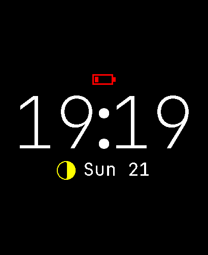
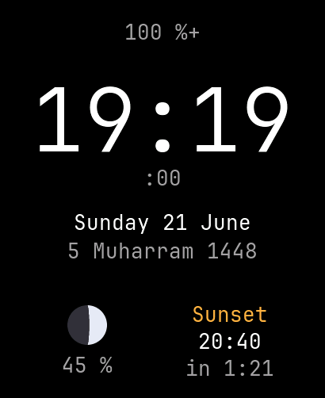
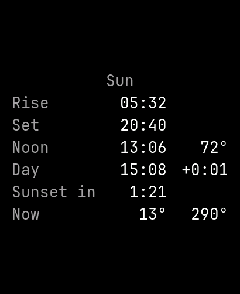
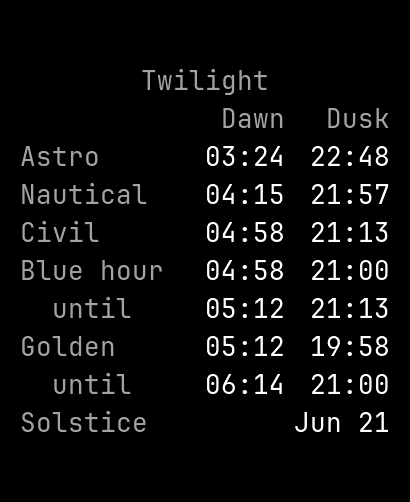
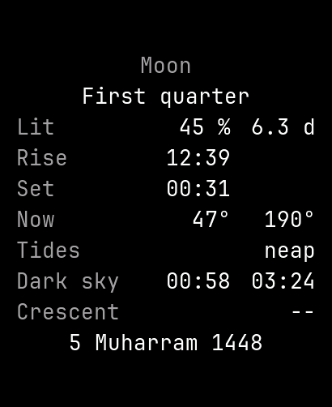
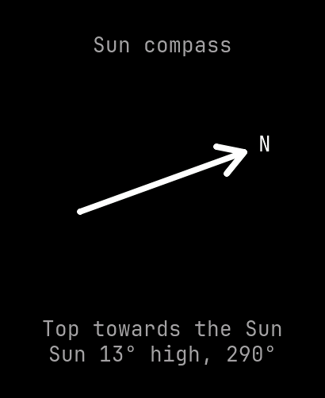
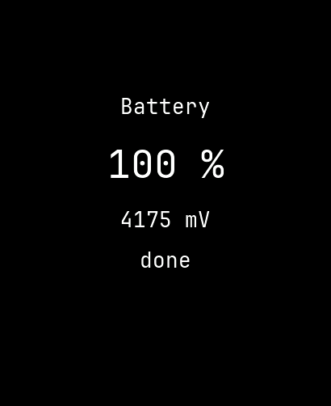
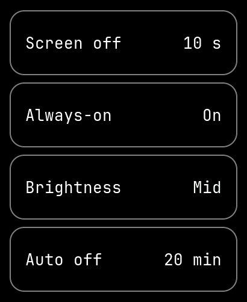
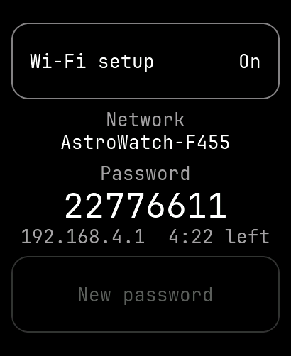
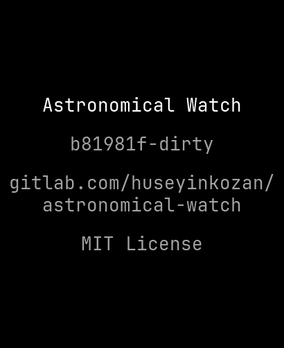

# Astronomical Watch

A personal low-power astronomical watch based on the **Waveshare ESP32-S3-Touch-AMOLED-2.06**.

It shows the time, date and astronomical information computed on the device. Location, date/time,
UTC offset and the other settings are entered on a setup page that the watch serves over its own
Wi-Fi for a few minutes (started on the watch), from any phone or computer browser; no internet,
GPS or online service is used. Battery life has priority over features: the processor sleeps most
of the time. Between interactions a dim
always-on face shows the time; when the watch has not moved for a while, it switches itself off
and the PWR key turns it on again.

## Planned Features

- Time and date
- Sunrise, sunset, solar noon, civil/nautical/astronomical twilight, day length
- Moon phase, illumination, age, moonrise and moonset
- Battery level
- Alarms at a clock time or relative to a sun or moon event (sunrise, twilights, solar noon,
  sunset, moonrise, moonset), with an offset; a countdown timer; signalled by vibration
- PWR key opens the interactive mode (touch, pages); after a configurable timeout the watch
  returns to a dim always-on face, updated once a minute, or switches off (setting)
- Switches off after a long time without motion (checked at wide intervals); the PWR key turns it on
- Switches off at 10 % battery, so that the clock keeps time for days; the PWR key still shows the
  watch until the display timeout
- Setup page over the watch's own Wi-Fi, started with a button on the watch's Setup page and
  stopped by the button, a save or a timeout (captive portal, password shown on the watch): time
  and UTC offset from the browser, location from a country/city list or coordinates, and every
  other setting

## Screenshots

Active-mode pages, swiped sideways (taken from the watch with `tools/screenshot.py`, in a fixed
scene: Istanbul, 21 June 2026, 19:19). Left of the watch face is the always-on page: a swipe up or
down there, or on the watch face, steps through the styles, and the one left showing is kept:

| Always-on styles | Watch faces |
|---|---|
|  |  |

The always-on face is shown at full brightness; the watch dims it to 10 %. Its fourteen styles
are seven digit styles (JetBrains Mono Thin, Light and Regular, and seven segments drawn with
dots in four ways), each as HH:MM or as hours over minutes.

| Sun | Twilight | Moon | Sun compass |
|---|---|---|---|
|  |  |  |  |

| Battery | Settings | Setup | About |
|---|---|---|---|
|  |  |  |  |

## Hardware

Waveshare ESP32-S3-Touch-AMOLED-2.06: ESP32-S3R8, 410 × 502 AMOLED (CO5300), FT3168 touch,
QMI8658 IMU, PCF85063 RTC, AXP2101 PMIC, battery connector.
Pins, power tree and device notes are in [docs/hardware.md](docs/hardware.md).

## Software

ESP-IDF v6.1, C++17, LVGL, Waveshare board support package.

## Build and Flash

```bash
source ~/.espressif/v6.1/esp-idf/export.sh
idf.py build
idf.py -p /dev/ttyACM0 flash monitor
```

## Host Tests

The astronomy code (`main/Astronomy.*`, `main/Hijri.*`) does not depend on ESP-IDF and is tested
on the computer against reference values from [Skyfield](https://rhodesmill.org/skyfield/) with
NASA JPL's DE421 ephemeris, and against the Hijri month starts published by Turkey's Diyanet:

```bash
sh tests/run_host_tests.sh          # needs only g++
```

The reference values are in the repository. To make them again (Python, about 20 MB):

```bash
sh tools/setup_reference.sh         # Skyfield and the ephemeris in tools/.venv
tools/.venv/bin/python tools/make_astronomy_reference.py > tests/astronomy_reference.csv
```

## Project Structure

```text
astronomical-watch/
├── CLAUDE.md             development rules
├── README.md
├── CMakeLists.txt
├── sdkconfig.defaults    project configuration (sdkconfig is generated)
├── dependencies.lock     locked component versions
├── docs/hardware.md      hardware fact base
├── partitions.csv        flash layout (4 MB application)
├── docs/screenshots/     pictures of the watch pages
├── tools/guided_test.py  guided hardware tests
├── tools/screenshot.py   screenshots from the watch (development build)
├── tools/make_cities.py  city list of the setup page, from GeoNames
├── tools/setup_reference.sh  Python environment for the astronomy reference values
├── tools/make_fonts.sh   watch fonts (main/fonts/) from tools/fonts/, needs Node.js
├── tools/make_aod_glyphs.py  always-on bitmaps (main/AodGlyphs.c), needs Pillow (tools/.venv)
├── tools/make_gifs.py    README animations from the screenshots, needs Pillow
├── tests/                host tests of the astronomy code and their reference data
├── main/                 application
└── archive/              earlier QMI8658 validator (reference only)
```

## Status

Restarted on ESP-IDF with C++17. The watch puts the unused peripherals into their lowest-power
state. A PWR press starts active mode: pages swiped sideways show the always-on face as it will look,
the watch face (classic, day arc, or hours over minutes, with the date, Hijri date, next sunrise
or sunset, Moon phase and battery; a vertical swipe changes the layout), the battery details, the settings (display timeout, always-on, brightness,
auto-off; one tap per value, kept in flash), the setup portal and an About page. The portal
opens the watch's own Wi-Fi for a phone or computer, whose browser sets the time, UTC offset,
location and settings. Four pages show the Sun (rise, set, noon, day length, time left until
sunset), the twilights with the golden and blue hours, the Moon (phase, rise and set, the dark
part of the night, the new crescent, the Hijri date) and a sun compass. 10 s after the last touch
(the default), or at the next PWR press, a
dim face in the chosen style (the time, the Moon's phase, the date, and a mark when the battery is
low) stays on the display while the processor deep-sleeps, redrawn once a minute. Every 10 min the accelerometer is read once; when the watch has not moved for 30 min it
switches itself off through the power-management IC, and a PWR press of at least half a second
turns it on again.
The earlier Wake-on-Motion validation results are kept in `docs/hardware.md`, and the validator
itself in `archive/wom-validator/` (git tag `wom-validator`).

## Roadmap

Each step is built, verified on the board and documented before the next one starts.

1. **M1** (done): PWR key wake from deep sleep, wake statistics kept across sleep.
2. **M2** (done): unused peripherals in their lowest-power state, battery drain runs (about 1.5 mA
   remained in deep sleep; holding the idle pads lowered it to about 1.2 mA, an estimate
   calibrated with a known load; the search continues).
3. Off mode (done): software power-off through the AXP2101 and power-on with the PWR key; the
   battery charges while the watch is off.
4. **M3** (done; crystal drift measurement running): RTC (PCF85063) time in UTC, set from the
   host, kept through off mode.
5. **M4** (done): display basics (time, date and battery through LVGL; panel power on ALDO2).
6. **M5** (done): always-on face with a minute-aligned wake; wake time 0.37 s per minute with
   `CONFIG_BOOTLOADER_SKIP_VALIDATE_IN_DEEP_SLEEP`; about 3 mA in always-on with the panel's
   idle mode (estimate from battery runs; about 45 h per charge of the supplied cell, which
   behaves like about 150 mAh).
7. **M6** (done): motion check at wide intervals in always-on (one 0.1 s accelerometer reading
   every 10 min, 10 mg threshold measured on a desk and on the wrist; power-off after 30 min
   without motion).
8. **M7** (done): active mode (touch, two swipeable pages, display timeout, PWR press to always-on).
9. **M8** (done): settings in NVS and the settings page on the watch (display timeout, always-on,
   brightness, auto-off; the setup button, password and IP address follow with M9).
10. **M9** (done): setup portal over Wi-Fi (time, UTC offset, location, all settings; the page
    opens by itself on a phone, the time is set to within a few milliseconds of the browser's
    clock) and the local time on the faces; the minute wake did not grow with the Wi-Fi stack.
    An About page and screenshots from the watch came with it.
11. **M10** (in progress): astronomy on the watch (sun and moon events and positions, twilights,
    golden and blue hour, sun compass, Hijri date by local crescent visibility or Diyanet's rule),
    a monospaced font with the Turkish letters (JetBrains Mono), three watch face layouts and
    fourteen always-on styles chosen with a vertical swipe or in the setup portal, with
    selectable items (done); next, the power cost of the always-on styles (lit pixels against the
    panel's fixed cost, battery run V).
12. **M11**: languages: Turkish and English on the watch and the setup page, chosen in the
    settings.
13. Vibration motor.
14. Alarms (clock time and sun/moon events) and countdown timer, also set through the portal.

## License

MIT, see [LICENSE](LICENSE). Dependencies (ESP-IDF, the Waveshare BSP, LVGL) keep their own
licenses. The setup page's city list comes from [GeoNames](https://www.geonames.org/) (CC BY 4.0);
`main/dns_server.*` is ESP-IDF example code (CC0); `main/LandMask.h` is made from
[Natural Earth](https://www.naturalearthdata.com/) land (public domain). The watch font is
[JetBrains Mono](https://github.com/JetBrains/JetBrainsMono) (SIL Open Font License 1.1,
`tools/fonts/OFL.txt`).
