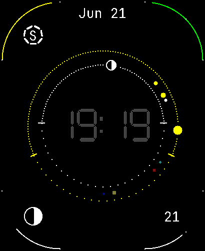

# Astronomical Watch

A personal low-power astronomical watch on the **Waveshare ESP32-S3-Touch-AMOLED-2.06**. Everything
is computed on the watch from the time and the location set on its own setup page; no internet,
GPS or online service is used. Battery life comes first: the processor sleeps most of the time.

Try it in the browser and install it from there: **https://huseyinkozan.gitlab.io/astronomical-watch/**
(also on [GitHub Pages](https://huseyinkozan.github.io/astronomical-watch/)).

## Features

- Face pages composed on the setup page: a digital or analog clock, large or among the Sun's and
  the Moon's paths (with the Milky Way and the planets), with lines and corners of information
- Sun: rise, set, noon, twilights, golden and blue hours, day length, a sun compass
- Moon: phase, illumination, age, rise and set, the new crescent; the Hijri date
- Tide: an approximate tide from the Moon and the coast's interval, as a corner gauge, a wave
  icon and a day's curve
- Prayer times by Diyanet's method; solar, ezani and sidereal time, the qibla time
- Planets: the solar system, the sky, rise and set, distances
- Clock page: world clock, stopwatch, countdown (with a regatta start), Gregorian and Hijri
  calendars with Diyanet's religious days, day counters, alarms
- Tools: torch (red, amber, white, SOS), calculator, unit converter, spirit level with a
  height and distance sight, counter, dice and coin, metronome, emergency card
- Observing: an astrolabe with alidade, sundial and analemma, polar alignment, the Milky Way
  window, a deep-sky finder (Messier), eyepiece and night-photo calculators, a nautical almanac,
  satellite dish and solar panel aiming
- Cycle page: menstrual cycle tracking entered and read on the watch, an optional PIN, the
  next period's range, the fertile days as an estimate (not for contraception), warning signs,
  an adolescent mode and Diyanet's hayız rulings; hidden until shown
- A launcher lists every page's parts; a tap opens one, the BOOT key steps back
- Alarms at a clock time or a sky event or prayer time; they beep through the speaker
- Gauges in the screen corners: the battery, day or night, the Moon, the display timeout, the
  next prayer and more; a Wi-Fi icon to the setup page and the emergency card's blood type on the face
- A dim always-on face between uses; switches itself off when not moved or at 10 % battery
- A red night mode from dusk to dawn, so that the eyes stay used to the dark
- Setup page over the watch's own Wi-Fi: time, location, faces, alarms, settings, software
  updates, a factory reset
- English and Turkish

## Screenshots

| Always-on faces | Face pages |
|---|---|
|  |  |

Every page and part, the default face pages, and the setup portal: **[English](docs/screenshots/en/README.md)** ·
**[Türkçe](docs/screenshots/tr/README.md)**. Taken from the watch in a fixed scene (Istanbul,
21 June 2026, 19:19); the always-on face is shown at full brightness, the watch dims it.

## Install and Update

The [site](https://huseyinkozan.gitlab.io/astronomical-watch/) installs the latest release from the
browser (Chrome or Edge on a computer). Releases are on the project's release page (GitLab and
GitHub), each with two files:

- `astronomical_watch-<version>-full.bin`: the first install over USB, one command
  (Python's esptool; if no port appears, hold BOOT while pressing PWR for the download mode).
  It also clears the settings, so it is meant for the first install only:

  ```bash
  pip install esptool
  esptool --chip esp32s3 -p /dev/ttyACM0 write-flash 0x0 astronomical_watch-<version>-full.bin
  ```

- `astronomical_watch-<version>.bin`: later updates from a phone, no computer needed: start the
  setup portal on the watch (Settings, Wi-Fi setup) and follow its "Software update" page.

## Hardware

Waveshare ESP32-S3-Touch-AMOLED-2.06 (ESP32-S3, 410 × 502 AMOLED, AXP2101, PCF85063, QMI8658).
Details: [docs/hardware.md](docs/hardware.md).

## Build

ESP-IDF v6.1, C++17, LVGL. Release and test builds: [CLAUDE.md](CLAUDE.md).

```bash
source ~/.espressif/v6.1/esp-idf/export.sh
idf.py build
idf.py -p /dev/ttyACM0 flash monitor
sh tests/run_host_tests.sh    # astronomy tests on the computer (g++), against Skyfield and JPL DE421
```

## License

MIT, see [LICENSE](LICENSE). Dependencies (ESP-IDF, the Waveshare BSP, LVGL) keep their own
licenses. The setup page's city list comes from [GeoNames](https://www.geonames.org/) (CC BY 4.0);
`main/dns_server.*` is ESP-IDF example code (CC0); `main/LandMask.h` is made from
[Natural Earth](https://www.naturalearthdata.com/) land (public domain); the Messier table
(`main/Messier.cpp`) comes from NASA HEASARC's catalogues and the magnetic model
(`main/Magnetic.cpp`) is NOAA's World Magnetic Model WMM2025 (both public domain). The watch font is
[JetBrains Mono](https://github.com/JetBrains/JetBrainsMono) (SIL Open Font License 1.1,
`tools/fonts/OFL.txt`).
