# Screenshots

[Türkçe](../tr/README.md) · [Back to the README](../../README.md)

Three tiles side by side: the watch face, the page list (launcher) and the page last opened from it; a sideways swipe moves between them. A swipe up or down steps through the face pages, and through the parts of a page, shown below each other. Each face page is shown beside its always-on face, the dim form the watch shows when active mode ends on that page (here at full brightness). Taken from the watch with `tools/screenshot.py` in a fixed scene: Istanbul, 21 June 2026, 19:19; the cycle page shows a sample cycle.

## Watch face and page list

<table>
<tr>
<th>Face page</th>
<th>Always-on</th>
<th>Page list</th>
</tr>
<tr>
<td>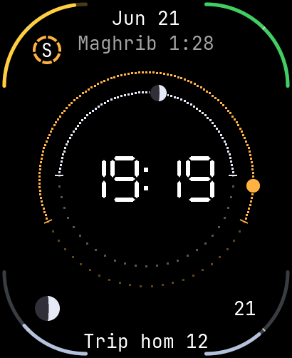</td>
<td></td>
<td>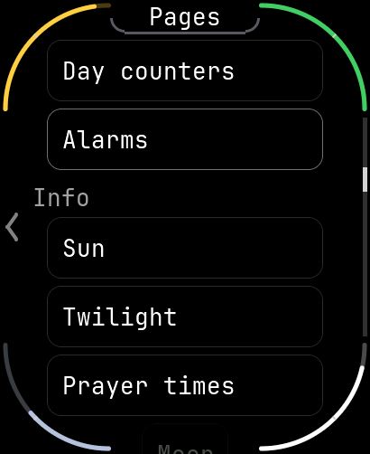</td>
</tr>
<tr>
<td></td>
<td></td>
<td></td>
</tr>
<tr>
<td>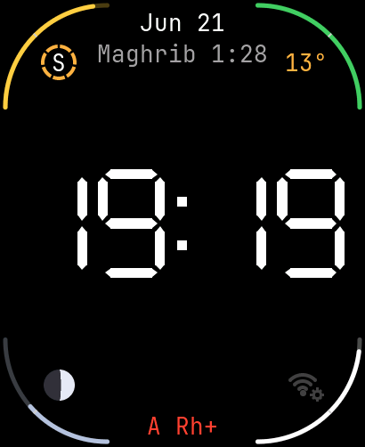</td>
<td></td>
<td></td>
</tr>
<tr>
<td></td>
<td></td>
<td></td>
</tr>
<tr>
<td></td>
<td></td>
<td></td>
</tr>
</table>

## Pages

<table>
<tr>
<th>Clock</th>
<th>Information</th>
<th>Tools</th>
<th>Observing</th>
<th>Planets</th>
<th>Cycle</th>
<th>Settings</th>
</tr>
<tr>
<td>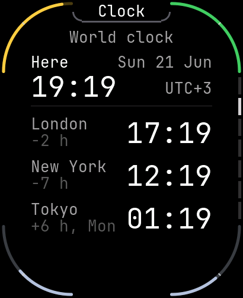</td>
<td>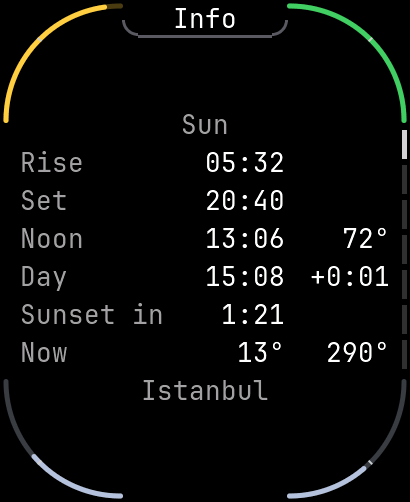</td>
<td>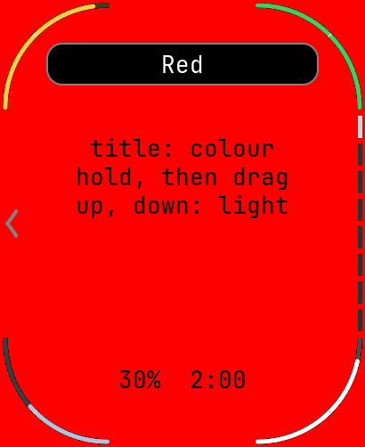</td>
<td>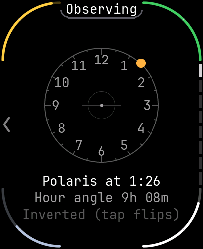</td>
<td></td>
<td>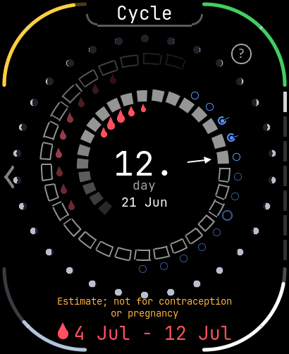</td>
<td>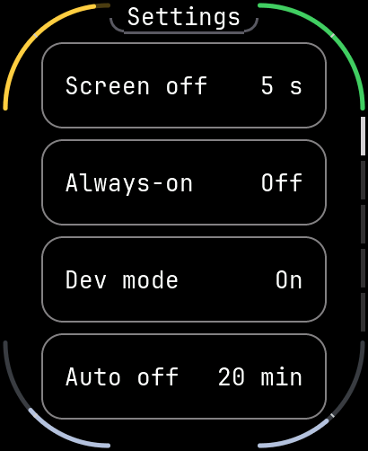</td>
</tr>
<tr>
<td>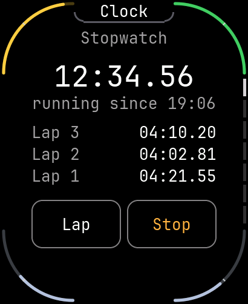</td>
<td></td>
<td>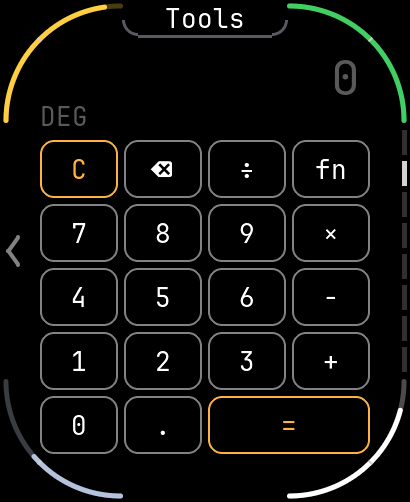</td>
<td>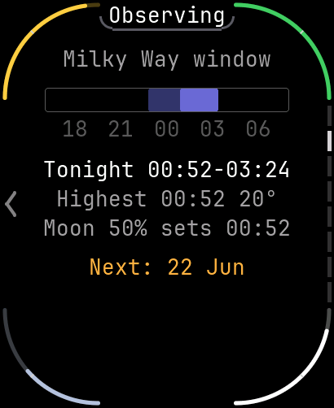</td>
<td></td>
<td>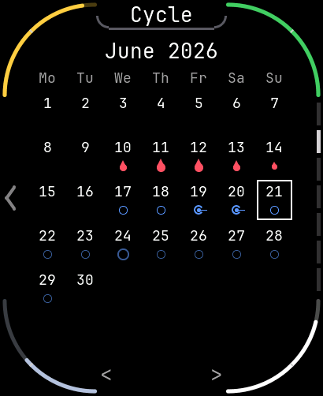</td>
<td></td>
</tr>
<tr>
<td>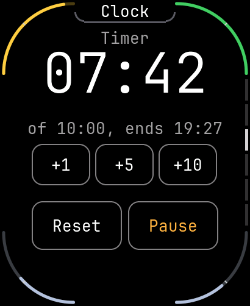</td>
<td>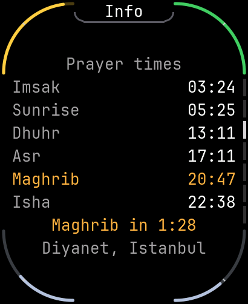</td>
<td>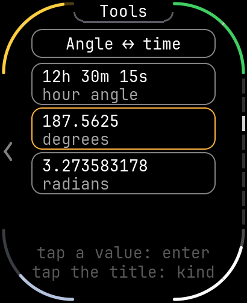</td>
<td>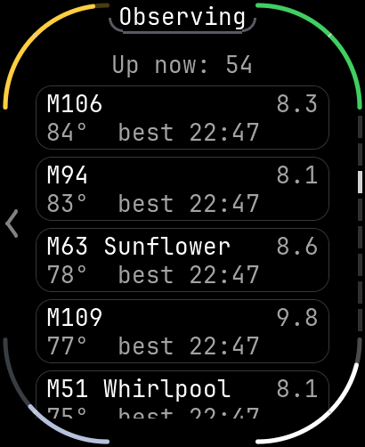</td>
<td>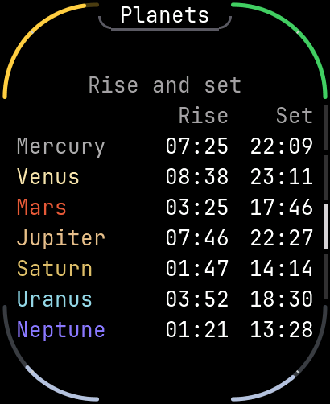</td>
<td>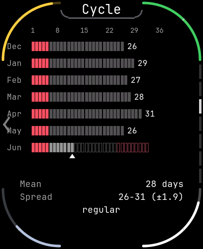</td>
<td>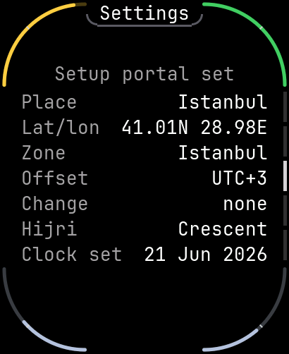</td>
</tr>
<tr>
<td></td>
<td>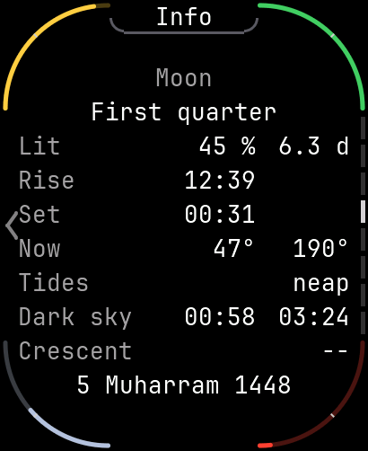</td>
<td>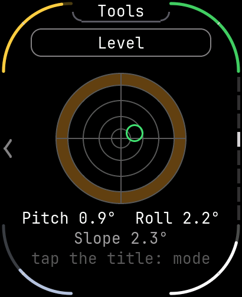</td>
<td>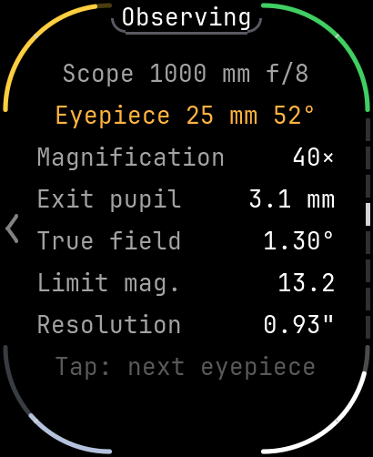</td>
<td></td>
<td>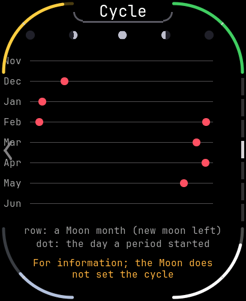</td>
<td>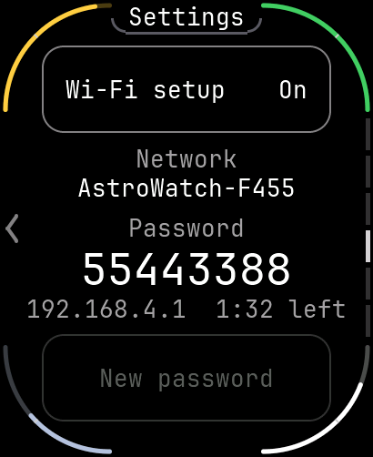</td>
</tr>
<tr>
<td>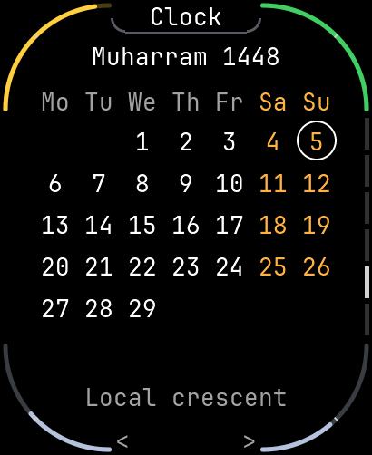</td>
<td>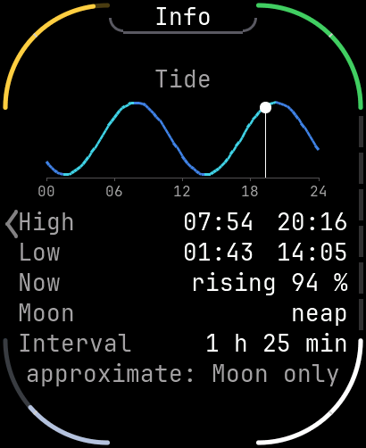</td>
<td>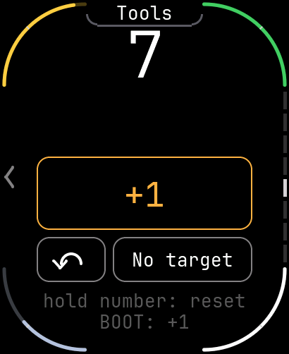</td>
<td>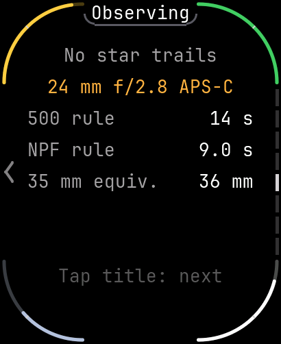</td>
<td></td>
<td>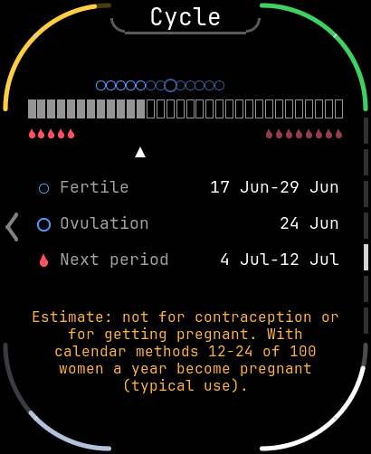</td>
<td></td>
</tr>
<tr>
<td></td>
<td>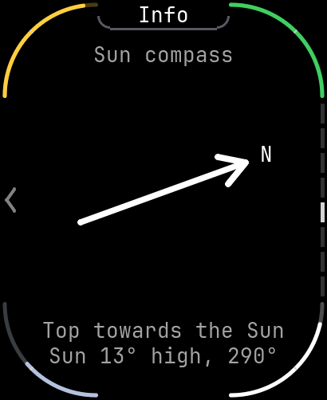</td>
<td>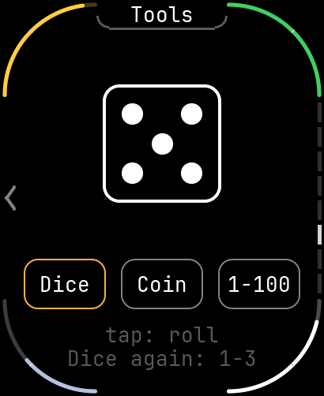</td>
<td>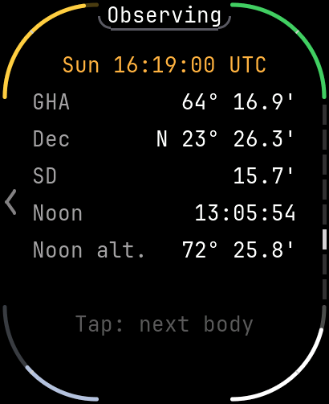</td>
<td></td>
<td>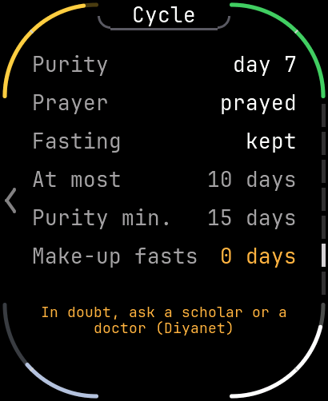</td>
<td></td>
</tr>
<tr>
<td>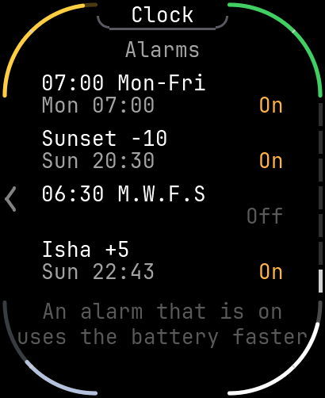</td>
<td></td>
<td>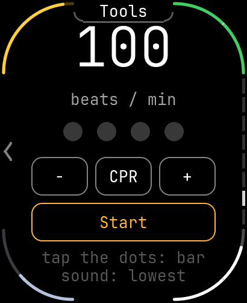</td>
<td>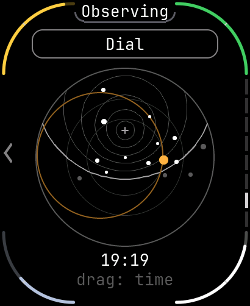</td>
<td></td>
<td>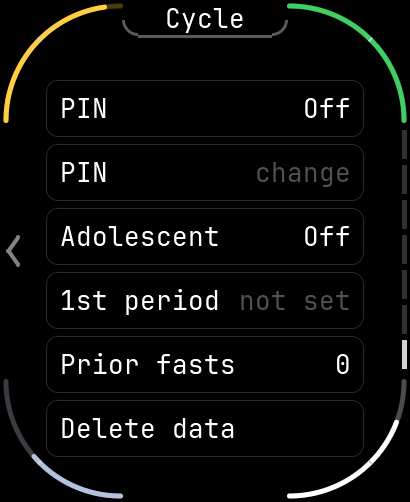</td>
<td>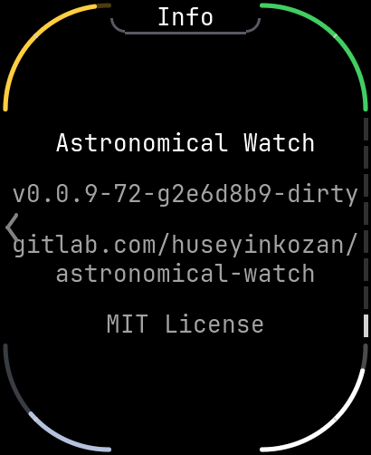</td>
</tr>
<tr>
<td></td>
<td></td>
<td>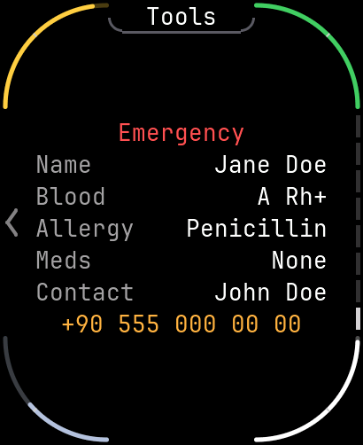</td>
<td>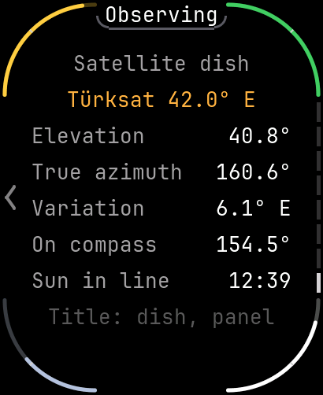</td>
<td></td>
<td></td>
<td>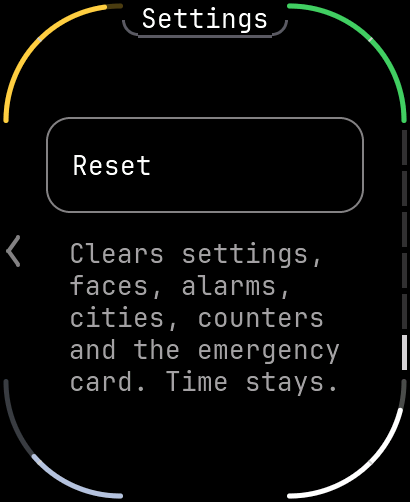</td>
</tr>
</table>

## Setup page

The setup page the watch serves over its own Wi-Fi, and the software update page (pictures by `tools/portal_preview.py`).

<table>
<tr>
<th>Time and place</th><th>Faces</th><th>Update page</th>
</tr>
<tr>
<td valign="top"></td>
<td valign="top">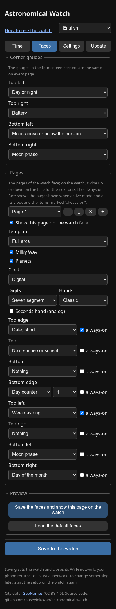</td>
<td valign="top">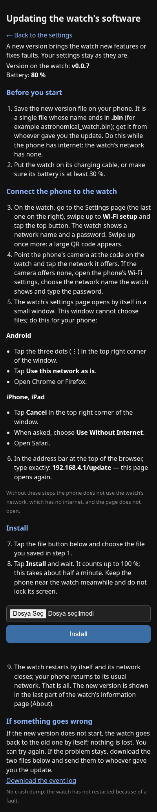</td>
</tr>
</table>
