# Screenshots

[Türkçe](../tr/README.md) · [Back to the README](../../README.md)

The watch's five pages side by side, as a sideways swipe moves between them; a swipe up or down steps through the parts of a page, shown below each other (on the first two pages: the styles). Taken from the watch with `tools/screenshot.py` in a fixed scene: Istanbul, 21 June 2026, 19:19. The always-on face is shown at full brightness; the watch dims it.

<table>
<tr>
<th>Always-on</th>
<th>Watch face</th>
<th>Clock</th>
<th>Information</th>
<th>Settings</th>
</tr>
<tr>
<td></td>
<td></td>
<td>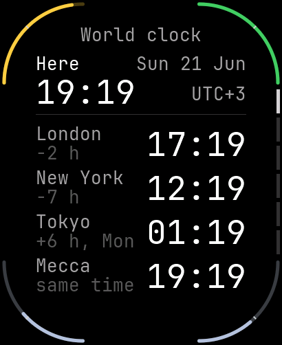</td>
<td>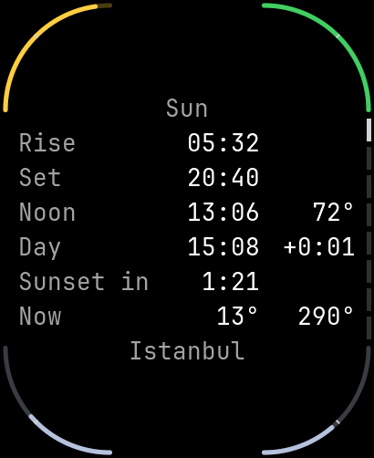</td>
<td>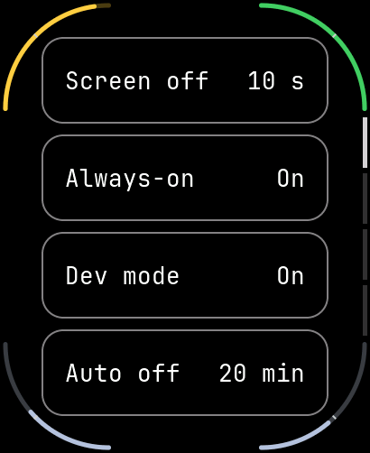</td>
</tr>
<tr>
<td>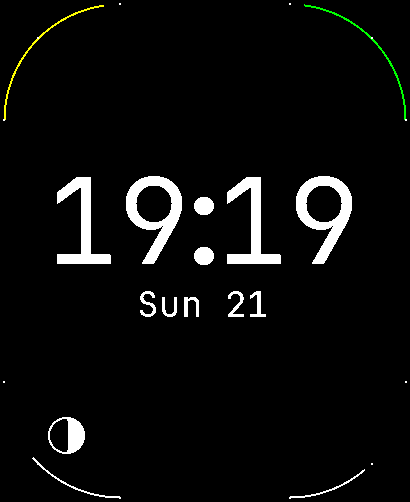</td>
<td></td>
<td>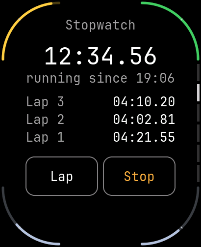</td>
<td>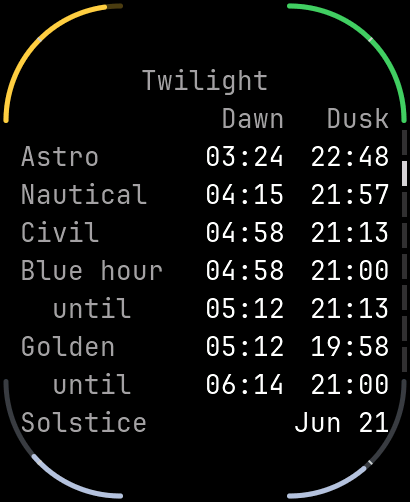</td>
<td>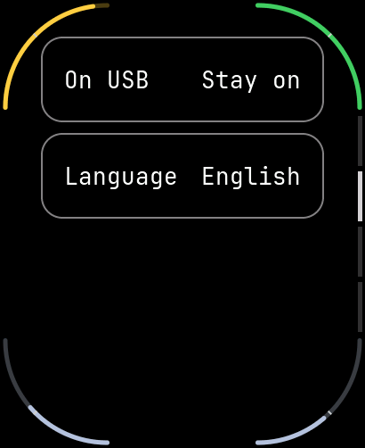</td>
</tr>
<tr>
<td></td>
<td></td>
<td>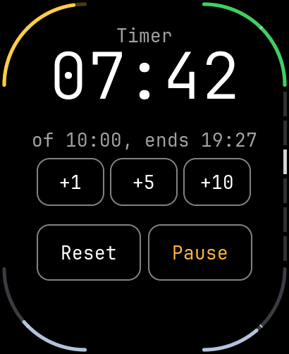</td>
<td>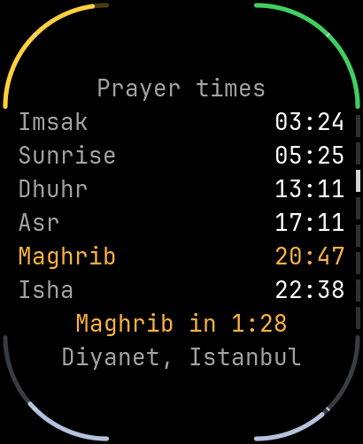</td>
<td>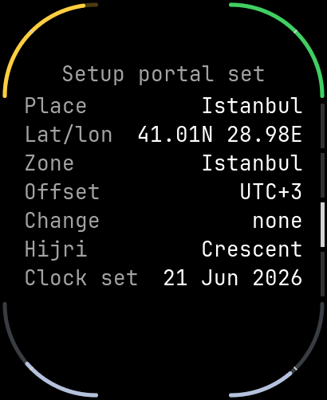</td>
</tr>
<tr>
<td>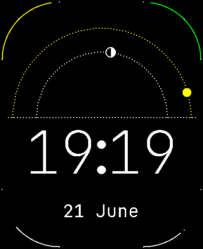</td>
<td>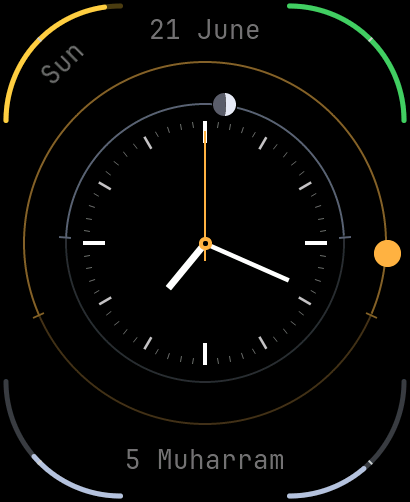</td>
<td>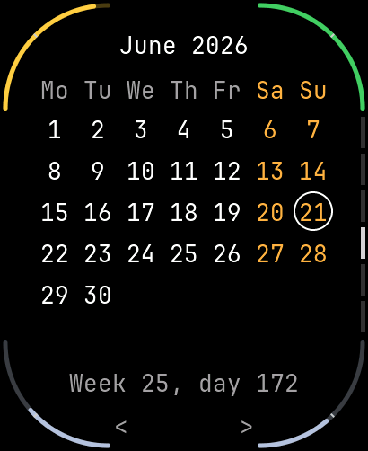</td>
<td>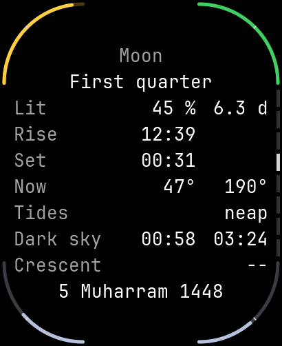</td>
<td>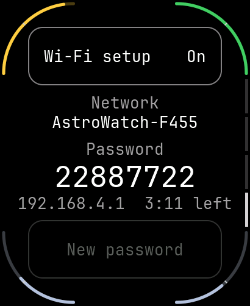</td>
</tr>
<tr>
<td>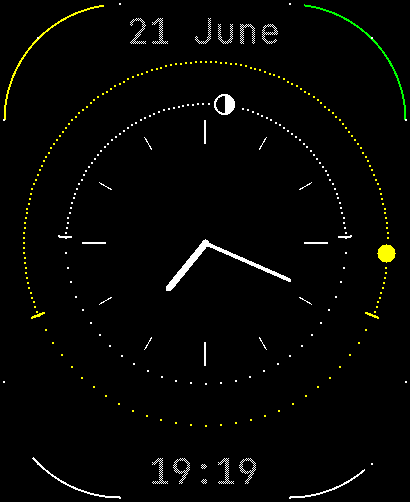</td>
<td></td>
<td>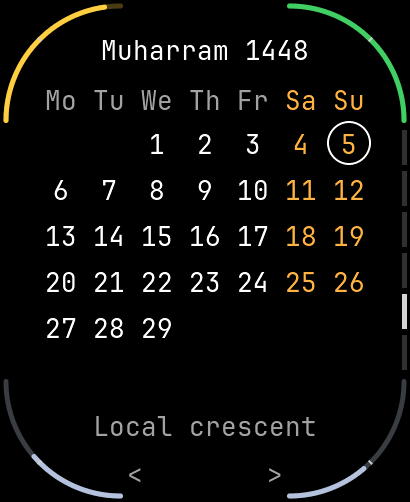</td>
<td>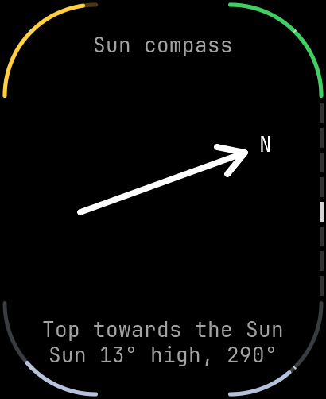</td>
<td></td>
</tr>
<tr>
<td></td>
<td></td>
<td>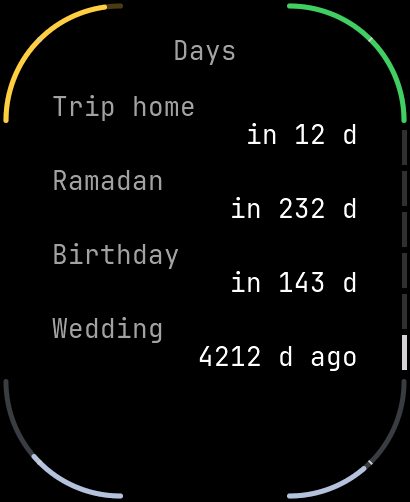</td>
<td>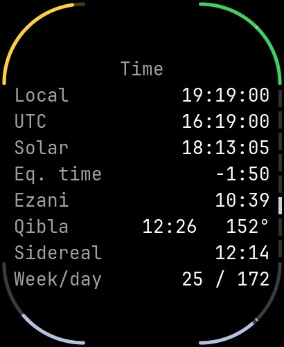</td>
<td></td>
</tr>
<tr>
<td></td>
<td></td>
<td></td>
<td>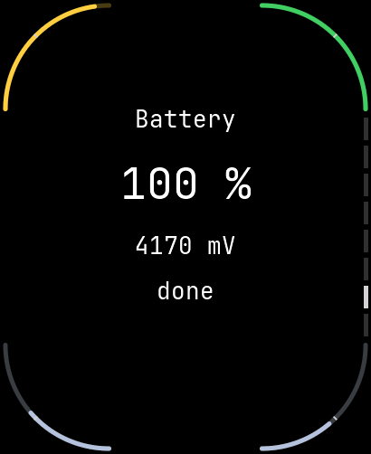</td>
<td></td>
</tr>
<tr>
<td></td>
<td></td>
<td></td>
<td>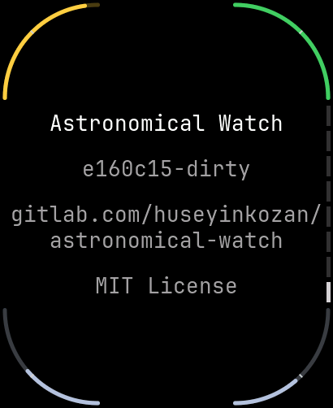</td>
<td></td>
</tr>
</table>

## Setup portal

The setup page the watch serves over its own Wi-Fi, and its software update page (pictures from `tools/portal_preview.py`).

<table>
<tr>
<th>Settings page</th><th>Update page</th>
</tr>
<tr>
<td valign="top"></td>
<td valign="top"></td>
</tr>
</table>
