# Ekran görüntüleri

[English](../en/README.md) · [README'ye dön](../../README.md)

Saatin dört sayfası yan yana; yana kaydırma aralarında geçer. Yukarı ya da aşağı kaydırma bir sayfanın parçalarına geçer; parçalar alt alta gösterilmiştir. Ön yüzde beş varsayılan yüz sayfası, her birinin yanında bekleme yüzüyle: etkin mod o sayfada bitince saatin gösterdiği soluk biçim. Görüntüler saatten `tools/screenshot.py` ile sabit bir sahnede alındı: İstanbul, 21 Haziran 2026, 19:19. Bekleme yüzü tam parlaklıkta gösterilmiştir; saat onu soluklaştırır.

<table>
<tr>
<th>Ön yüz</th>
<th>Bekleme</th>
<th>Saat</th>
<th>Bilgi</th>
<th>Ayarlar</th>
</tr>
<tr>
<td>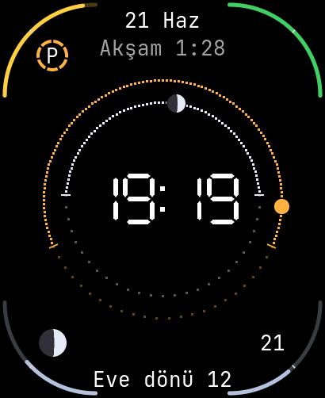</td>
<td></td>
<td>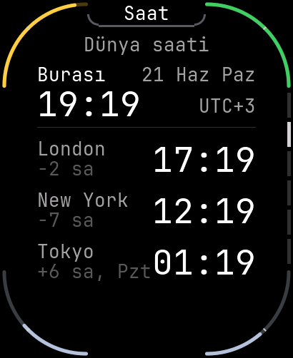</td>
<td>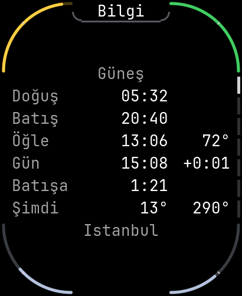</td>
<td>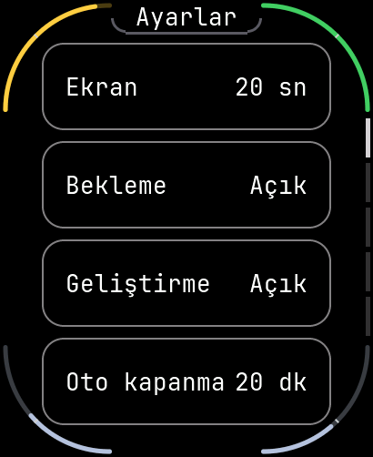</td>
</tr>
<tr>
<td>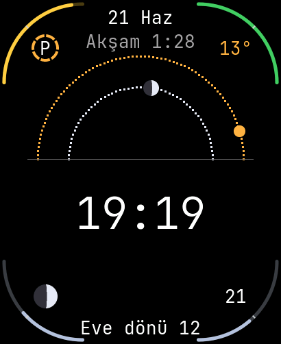</td>
<td>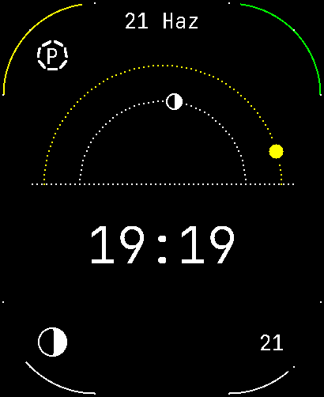</td>
<td>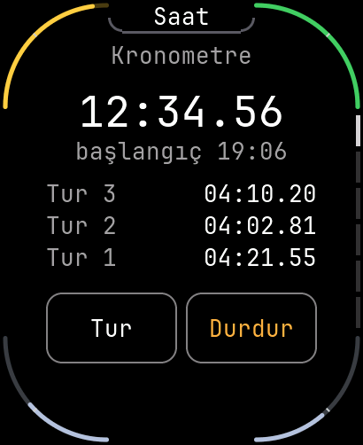</td>
<td>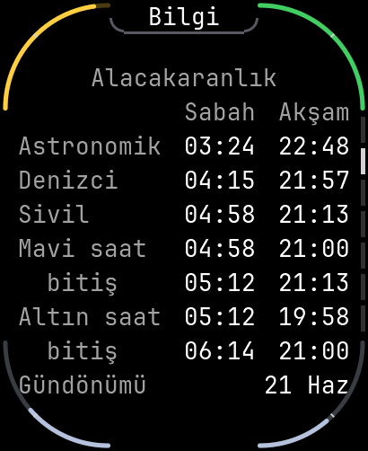</td>
<td>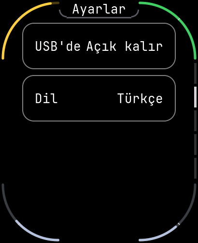</td>
</tr>
<tr>
<td></td>
<td></td>
<td>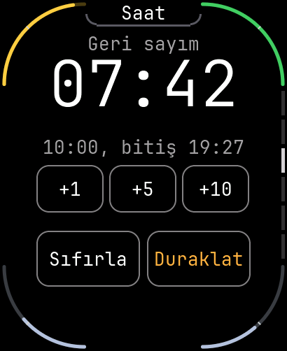</td>
<td>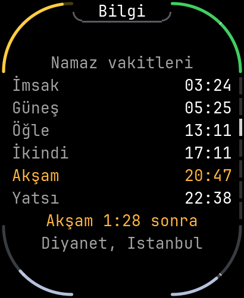</td>
<td>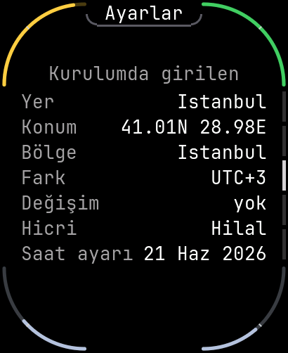</td>
</tr>
<tr>
<td></td>
<td></td>
<td>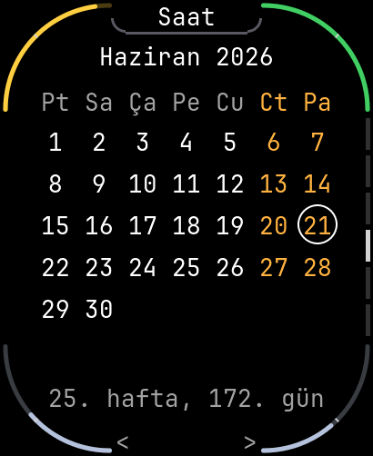</td>
<td>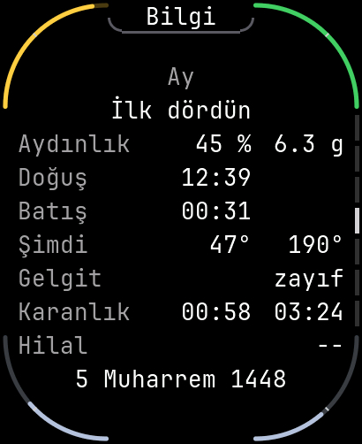</td>
<td>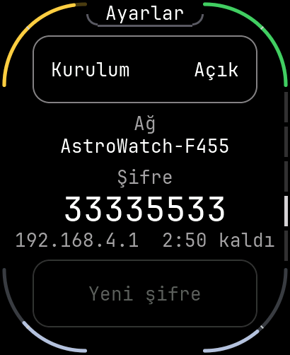</td>
</tr>
<tr>
<td>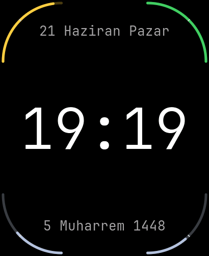</td>
<td>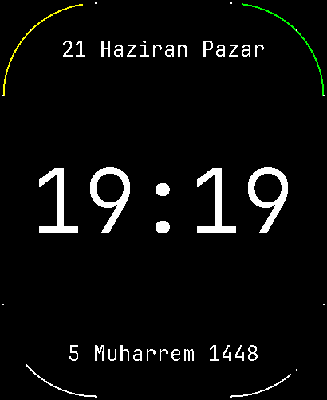</td>
<td>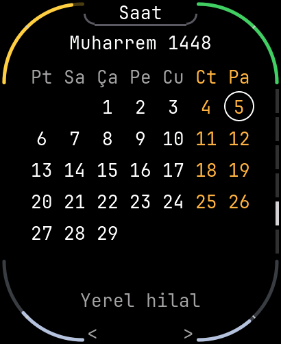</td>
<td>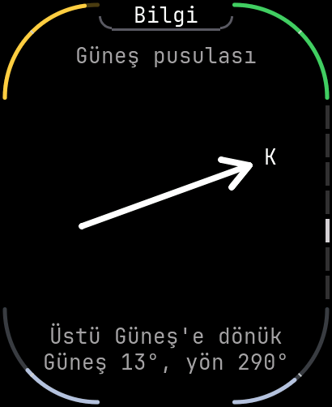</td>
<td>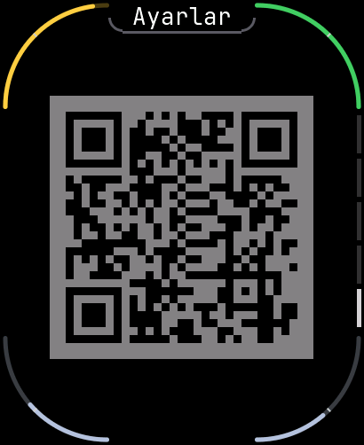</td>
</tr>
<tr>
<td></td>
<td></td>
<td>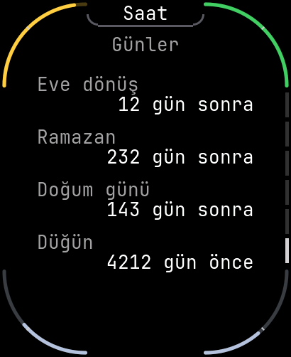</td>
<td>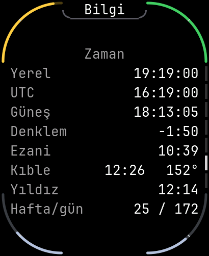</td>
<td></td>
</tr>
<tr>
<td></td>
<td></td>
<td></td>
<td>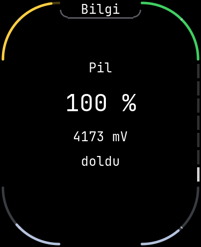</td>
<td></td>
</tr>
<tr>
<td></td>
<td></td>
<td></td>
<td>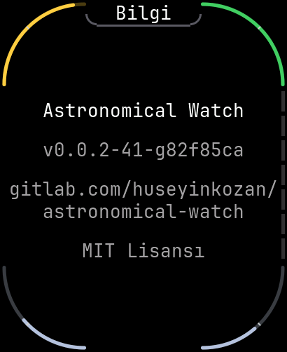</td>
<td></td>
</tr>
</table>

## Kurulum sayfası

Saatin kendi Wi-Fi'ı üzerinden sunduğu kurulum sayfası ve yazılım güncelleme sayfası (resimler `tools/portal_preview.py` ile).

<table>
<tr>
<th>Zaman ve yer</th><th>Yüzler</th><th>Güncelleme sayfası</th>
</tr>
<tr>
<td valign="top">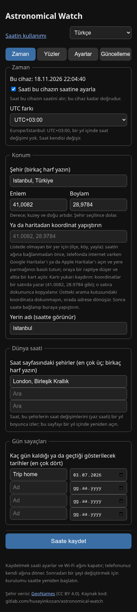</td>
<td valign="top">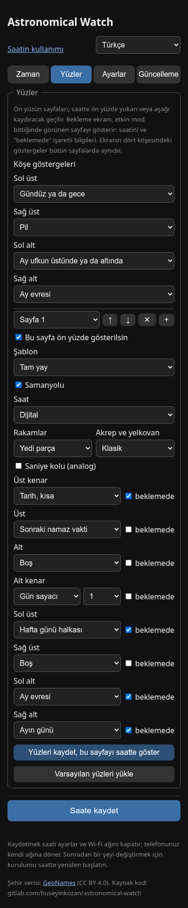</td>
<td valign="top"></td>
</tr>
</table>
